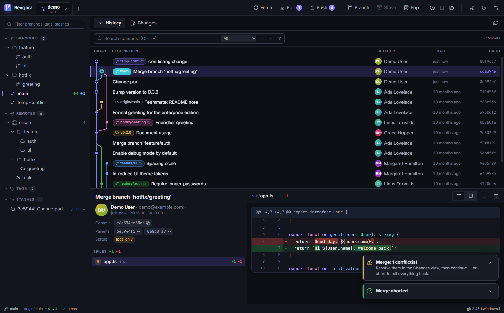
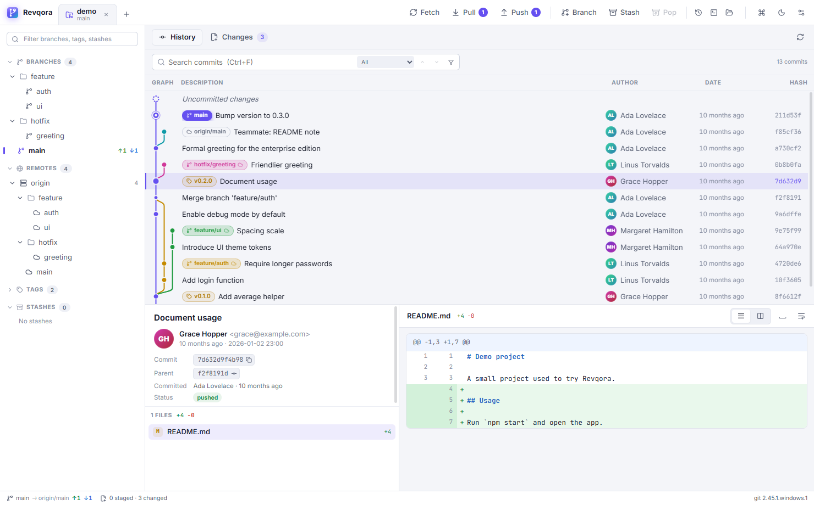
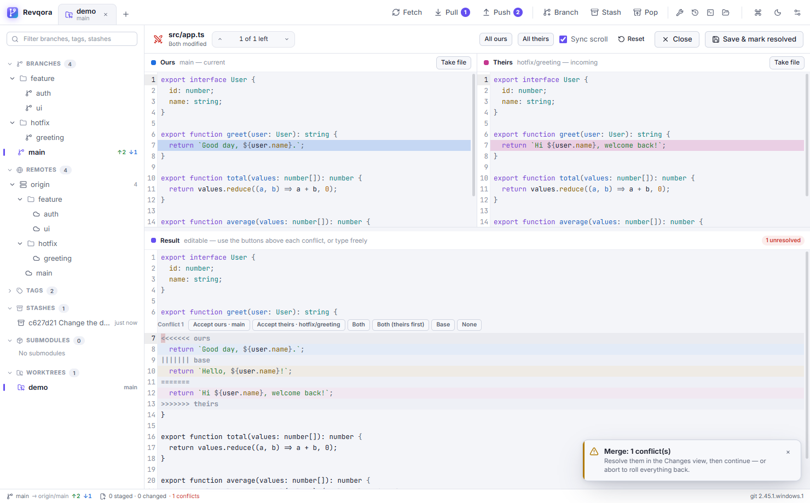
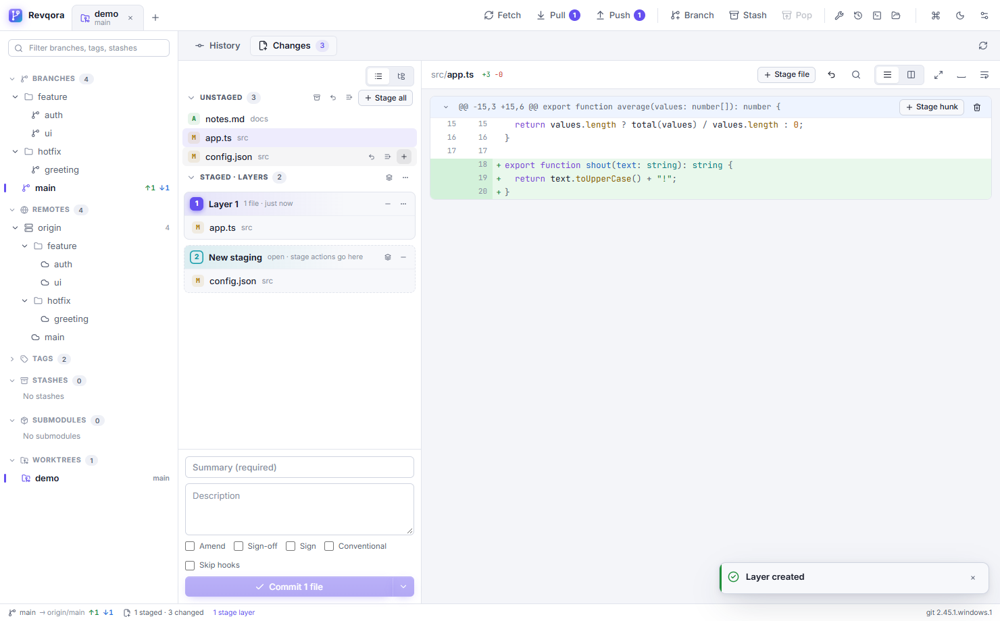

# Revqora

A fast, good-looking desktop Git client. Rust + Tauri 2 backend, React + TypeScript UI.



| History, light theme | Merge editor | Stage layers |
| --- | --- | --- |
|  |  |  |

Screenshots use a generated demo repository (`scripts/make-demo-repo.sh`); all names in it are fictional.

## Features

**History & graph**
- Virtualized commit graph (100k+ commits) with smooth lane curves, branch colors, draw-in animation, HEAD pulse and lane highlighting on hover.
- Ref badges for local / remote / tags; local branches in sync with their remote fold into one badge; unpushed commits are drawn hollow.
- Search by everything, message, author, hash, **code (pickaxe `-S`)** or file path, with next/prev and "show only matches".
- Commit details: message, author/committer, parents (click to jump), pushed/local status, file list with stats, syntax-highlighted diff (unified or side-by-side, word-level changes).
- Copy full/short hash, subject; double-click a row to copy its hash.
- Branch details: fork point, first and last commit dates, ahead/behind, authors, merged or not.
- Compare any two branches, tags or commits — "since branching" (like a pull request) or a direct diff, with files and commits.
- Blame with age bars, jump to the commit, and "blame the version before this commit" to dig further back.
- Image diffs (PNG, JPEG, GIF, WebP, …) side by side or with a swipe slider.
- File history; browse every file of any revision with `git grep` search.
- Diffs: collapse hunks, show the whole file, jump between changes (F7 / Shift+F7), find in diff (Ctrl+F), very long diffs render virtually.
- Graph: resizable graph column (more lanes), choose columns, history keeps loading past 150k commits, incremental rebuilds after commits and fetches.
- File lists flat or grouped by folder; drag files between Unstaged and Staged, drag a branch onto another to merge / rebase / compare.
- Large histories: two-phase loading (newest commits first) and a one-click offer to write git's commit-graph cache.

**Working copy**
- Stage / unstage / discard whole files, hunks or **single lines** (click line numbers, Shift-click for ranges).
- **Stage layers** — several staging areas stacked on top of each other. Seal what is staged into a layer, keep staging into a new one, then unstage, discard, reorder, merge or commit any layer on its own. Dependent layers (same lines changed again) are detected and reported instead of breaking anything.
- When layers overlap (a later layer edits lines an earlier one introduced), unstaging, moving or committing a layer opens the merge editor so you decide what the later change should look like on its own.
- Discards keep a backup copy in `.git/revqora/trash/`.
- Commit with amend, sign-off, skip hooks; commit & push.

**Merging without surprises**
- Merge never creates the commit by itself: you see the merged result (and any conflicts), then press **Confirm merge** — or **Abort** and everything rolls back.
- Strategies: merge commit, fast-forward if possible, squash.
- Three-pane merge editor (ours / theirs / editable result) built on CodeMirror: per-conflict *Accept ours / theirs / both / base / none*, conflict navigation (Alt+↑/↓), "all ours/all theirs", take whole file, binary and delete/modify conflicts.
- The same flow for cherry-pick, revert, rebase (continue / skip / abort), with a banner showing what is in progress.

**History editing (local commits)**
- Visual interactive rebase: drag commits to reorder and pick / reword / edit / squash / fixup / drop each one; squash groups get a combined message.
- Edit message (any commit on the branch), edit contents (stop the rebase there), squash, fixup into parent, move up/down, drop, undo last commit (keeps changes staged), reset soft/mixed/keep/hard.
- Undo history: the reflog, with "reset here".

**Branches, remotes, stash, tags**
- Create, checkout (remote → tracking local), rename, delete (with force for unmerged), set upstream, delete on remote.
- Fetch / pull (ff-only, merge or rebase) / push (set upstream, force-with-lease, tags) with live progress.
- Stash save (with untracked, keep index), apply, pop, drop; per-file stash.
- Annotated and lightweight tags, push tags.

**Submodules, worktrees, bisect, LFS, signing**
- Submodules: status (not cloned / moved / conflict), add, init + update (recursive), sync, open in a tab.
- Worktrees: create (existing or new branch), open in a tab, lock/unlock, remove, prune.
- Bisect: start from any commit, mark good / bad / skip from a banner, bisect labels in the graph, jump to the first bad commit.
- Git LFS: tracked patterns, track / untrack, pull / fetch / prune, list LFS files and whether they are downloaded.
- Commit signing: GPG, SSH or X.509 key settings (per repository or global), a Sign checkbox when committing, signature status in commit details.

**Taking things from other places**
- Apply a whole file, a hunk or single lines from any commit to the working tree; restore a file version.
- Compare any commit or branch with the working tree.
- Stash viewer with per-file restore; save commits as a patch file, apply .patch / .diff files (`git am` / `git apply`).
- Recently deleted branches (deleted in Revqora or found in the reflog) with one-click restore; per-branch reflog.

**Commits**
- Conventional Commits helper, `commit.template` support, autocomplete from recent subjects.
- Warns about large staged files and moves them to Git LFS in one click.
- Readable hook failures with "Retry" and "Commit without hooks".

**GitHub, GitLab & Bitbucket**
- Pull / merge requests: list, create (pushes the branch first), check out, compare, open in the browser; CI checks per PR and per commit. Works with GitHub (and Enterprise), GitLab, Bitbucket Cloud and Bitbucket Server / Data Center. The token comes from git's credential manager (OAuth, personal access tokens and Bitbucket app passwords).

**Self-contained git and credentials**
- Uses the Git already installed on the computer (shows a download link if it is missing); credentials go through its own credential manager.
- Username / password, SSH key passphrases and unknown-host questions from git and ssh appear in Revqora's own dialog (`GIT_ASKPASS` / `SSH_ASKPASS` point at the app itself; answers go straight to git over a local, token-protected socket and are not stored).
- Commands that change the working tree run exclusively per repository, so background refreshes never collide with checkout, stash or reset.

**Repository tools**: size, gc, repack, prune, commit-graph, scheduled background maintenance.

**App**
- Multiple repositories in tabs, restored on start; recent list; drag & drop a folder; `revqora <folder>` opens it.
- Dark and light themes (or follow the system), selectable UI / code fonts and sizes.
- Command palette (Ctrl+K), rebindable keyboard shortcuts, first-run guide, optional author pictures (Gravatar / GitHub, off by default), auto-refresh through a file watcher.
- Portable: unpack the zip anywhere and run `revqora.exe`; a second launch opens folders as tabs in the running window.
- Everything it remembers (recent repositories, open tabs, settings, window size) is kept only in a `data` folder next to the exe; nothing is stored in `%APPDATA%` or `%LOCALAPPDATA%`. Move or copy the folder as a whole; updates keep `data`. The app folder must be writable. On macOS and Linux only the window size goes there; the web view keeps its storage in the system location.
- Updates itself: checks GitHub Releases at startup (and every few hours); when a new version is out, an **Update** chip appears in the status bar. One click downloads the package for your platform, verifies its SHA-256 checksum and replaces the files in place, then "Restart to update" finishes it. Skip a version or turn checks off in Settings.

## Requirements

- Git 2.30+ installed (2.40+ for reordering/removing stage layers) — on Windows https://git-scm.com/download/win.
- Set `REVQORA_GIT` to force a specific git executable.
- Windows 10/11 (WebView2), macOS or Linux.

## Develop

```bash
npm install
npm run tauri dev
```

Release build and portable zip (`release/Revqora-<version>-win-x64.zip`):

```bash
npm run tauri build
npm run package
```

## Verify

```bash
npm run verify
```

Runs `cargo fmt --check`, `cargo clippy -D warnings`, the Rust unit and git workflow tests (real temporary repositories: line staging, layers, merge/abort, squash merge, cherry-pick conflicts, history rewriting, graph search, stash), the TypeScript typecheck, frontend unit tests, a release build and an end-to-end UI smoke test that drives the real app through WebView2 remote debugging. `npm run verify:quick` skips the release build and the UI test.

Helpers: `scripts/make-demo-repo.sh <dir>` builds a demo repository; `scripts/make-big-repo.py <dir> 100000` generates a large one for performance checks.

## Keyboard

| Keys | Action |
| --- | --- |
| Ctrl+O | Open repository |
| Ctrl+K / Ctrl+Shift+P | Command palette |
| Ctrl+1 / Ctrl+2 | History / Changes |
| Ctrl+F | Search commits |
| ↑ ↓ PgUp PgDn Home End | Move in the graph |
| Ctrl+C | Copy selected commit hash |
| Ctrl+Enter | Commit |
| F5 / Ctrl+R | Refresh |
| Ctrl+Tab / Ctrl+W | Next tab / close tab |
| Alt+↑ / Alt+↓, Ctrl+S | Merge editor: previous / next conflict, save |

## License

MIT
