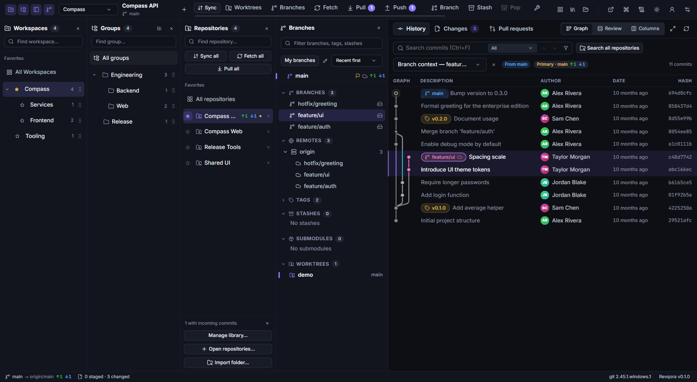
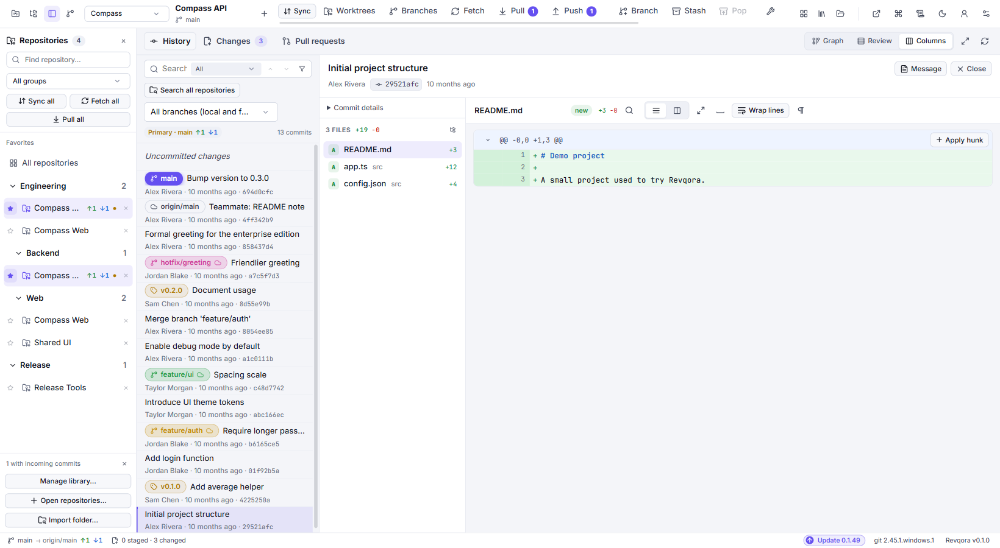
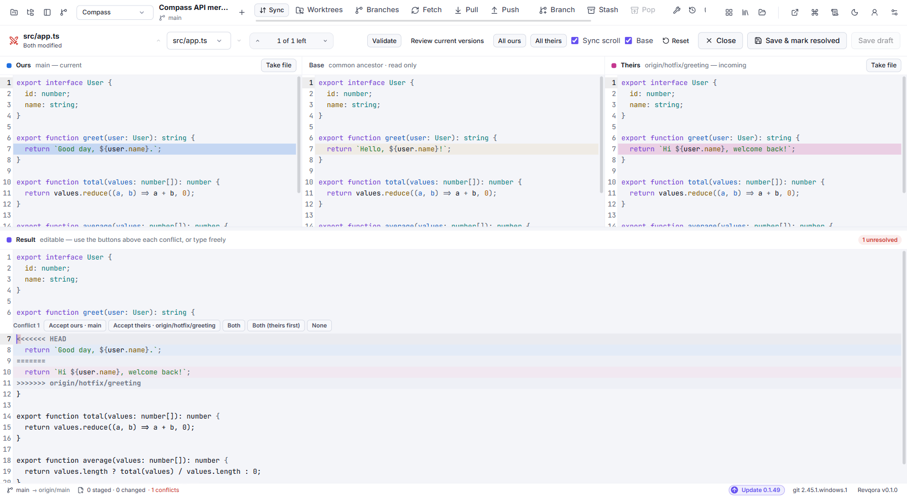
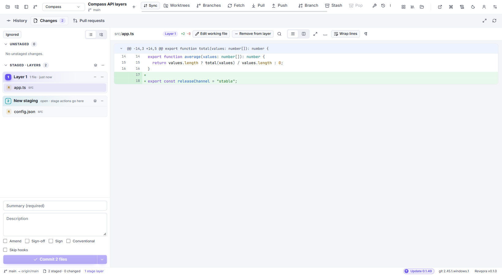

# Revqora

A desktop workspace for Git, code review and agent workflows. Manage repositories,
stage precise changes, understand history and review pull requests without leaving
the application.

Created by **[bitcodepro](https://github.com/bitcodepro)**. Built with Rust, Tauri 2,
React and TypeScript. Distributed under the [MIT license](LICENSE).

[Download](https://github.com/bitcodepro/Revqora/releases/latest) ·
[Quick start](#quick-start) · [Features](#features) · [How to use](#how-to-use) ·
[Keyboard shortcuts](#keyboard-shortcuts) · [Report an issue](https://github.com/bitcodepro/Revqora/issues)



| Light theme | Conflict editor | Stage layers |
| --- | --- | --- |
|  |  |  |

Screenshots use a demo repository with fictional names. This guide describes the
current source; check the release notes for the features included in a downloaded
build. The [online README](https://github.com/bitcodepro/Revqora#readme) also contains
the screenshots and links when reading a packaged copy.

## Quick start

### 1. Install and launch

Install [Git](https://git-scm.com/downloads), then download the matching archive
from [Releases](https://github.com/bitcodepro/Revqora/releases/latest).

| Platform | Package | Run |
| --- | --- | --- |
| Windows 10/11, x64 | `win-x64.zip` | Extract the entire archive, then open `revqora.exe`. Requires [WebView2 Runtime](https://developer.microsoft.com/en-us/microsoft-edge/webview2/). |
| Linux, x64 or ARM64 | `linux-x64.tar.gz` / `linux-arm64.tar.gz` | Extract and run `./revqora`. Requires WebKitGTK 4.1 and the platform's GTK/system libraries; this is not an AppImage. |
| macOS, Apple Silicon or Intel | `osx-arm64.zip` / `osx-x64.zip` | Extract and open `Revqora.app`. Packages are ad-hoc signed, not notarized. |

Use Git 2.30 or newer; advanced history tools, stage-layer operations and branch
stack restacking require Git 2.40 or newer. Git LFS, signing tools and agent CLIs
are optional dependencies for their respective features. Git is not bundled.
Rust and Node.js are only needed to build Revqora from source.

On Windows, choose a writable installation folder and run the extracted executable,
not the copy inside the ZIP. Keep the package files together. If Git is not found,
install it and use **Settings → Detect again**. `REVQORA_GIT` can select a specific
Git executable.

### 2. Open a repository

- Press **Ctrl+O** to open a local repository, or drag its folder into the window.
- Press **Ctrl+K**, then choose **Clone repository…** to clone a remote URL.
  You can paste either the URL or the complete `git clone <URL>` command copied
  from your hosting service, including an HTTPS username. Quoted sources are
  supported; choose the parent folder and folder name in the form. Extra command
  options and destination arguments are rejected with an explanation.
- Choose **New repository…** to initialize a local repository. This does not create
  a hosted repository on GitHub, GitLab or another service.
- Set your commit name and email in **Settings → Edit name & email** when needed.
  This identity is separate from the account used to access a hosting service.

### 3. Make your first commit

1. Edit files in your usual editor and open **Changes** with **Ctrl+2**.
2. Inspect a file's diff. Use **+** or double-click a file to stage it; select lines
   or a hunk when only part of the file belongs in this commit.
3. Check the **Staged** list, enter a summary and an optional description.
4. Choose **Commit** or **Commit & push**. Use **Push** to publish a local commit
   later; the first push may require selecting a remote and upstream branch.

**Staging chooses the content of the next commit.** It does not hide a file or
remove its edits. A normal commit includes staged changes; unrelated unstaged edits
remain in the working copy. If you edit a file again after staging it, the staged
and working versions can differ. **Unstage** removes it from the proposed commit
while keeping your edits.

**Stage again** updates the prepared file to its current complete contents:
earlier edits you left untouched stay included, and your newer edits take
precedence where you changed the file again. **Unstage after editing again**
keeps that latest complete file in your working copy. It does not restore the
older staged snapshot into the file. Ordinary Stage does not create extra layers;
use **Stage into a new layer** or **Seal into a layer** explicitly for that.

## Features

Right-click a repository or branch name to **Copy name** or **Copy path**.
For a branch, the path is its repository folder, not a file inside `.git`.
These actions are available in the sidebar, history graph branch badges,
Branch Manager, repository overview/library, recent repositories and active
repository/branch headers, plus worktree lists and Worktree Manager. In a worktree
list, **Copy path** uses that specific worktree's folder. Copying does not activate
or check out anything.

| Area | What you can do |
| --- | --- |
| Repository workspace | Open, initialize and clone repositories; use a searchable repository column, favorites, project groups and saved workspaces; Fetch/Pull/Sync across matching open repositories. |
| Review layouts | Switch between Graph, Review and Columns; hide repository and branch panels, resize file/diff panes, and keep visibility and widths separately for each layout. |
| History | Virtualized graph, ref labels, commit and branch details, search by message/author/SHA/code/path, branch comparison, file history, blame and revision browsing. |
| Diff | Unified and side-by-side views, word highlighting, line wrapping or horizontal scrolling, image comparison, hunk navigation, file-tree and flat file lists. |
| Changes and commits | Stage/unstage files, hunks and lines; discard with backups; ignored-file and nested-repository views; amend, sign-off, signed commits, templates and Conventional Commits helpers. |
| Stage layers | Keep several logical groups of staged work, inspect dependencies, reorder or combine layers, and commit a layer separately. |
| Branch management | Create, switch, rename, compare and delete branches; inspect upstream/ahead/behind; filter protected, stale, merged, unmerged or diverged branches; review bulk cleanup. |
| Git operations | Fetch, Pull, Push, explicit Sync, tags, stash and partial stash, patches, cherry-pick, revert, reset and reflog. |
| Rebase and conflicts | Rebase Studio with reorder/reword/squash/fixup/drop, previews and recovery; conflict editor with Base, Ours, Theirs and editable Result; selected validation commands. |
| Recovery | Operation log, Undo Center, recovery checkpoints, deleted-branch restoration and discard backups, with operation-specific recovery limits. |
| Worktrees and repository tools | Create/open/lock/remove/prune worktrees; submodules, LFS, bisect, signing, repository size and Git maintenance. |
| Pull Request Center | Browse, create and edit PRs/MRs; templates, changed files, discussions, inline comments, reviews, CI and supported policy-checked merge/cleanup actions. |
| Agent Workspace | Run an installed CLI in a reviewed worktree; inspect logs and changes, stop its process tree and keep native task history across restarts. |
| Workflow Builder | Save ordered checks, commands and reviewed Git/service steps; PR follow-up recipes connect agents, validation, publication, CI and re-review. |
| Code exploration | Local syntax-aware summaries for C#, TypeScript/TSX and JSON; literal changed-code search and symbol-body/JSON-subtree history. |
| Branch Stacks | Track dependent branches, link PRs, review one-layer restacks, retain recovery and old-parent boundaries after rewrites or squash merges. |

## How to use

### Work with many repositories

Show the repository column with **Ctrl+Alt+R**. Search, favorites and project groups
make large repository sets easier to navigate. Use **Manage library** to organize
them. The panel shows repository state and incoming/outgoing counts; remote counts
reflect the last Fetch.

At startup, Revqora opens all saved repositories and restores the last selection.
Named workspaces keep their own repository set. To restore only previously open
tabs, disable **Settings → Behaviour → Open all saved repositories**.

Use **Fetch all** to refresh matching open repositories, **Pull all** to receive
updates, or **Sync all** to review receiving and publishing together. Closed library
bookmarks do not run background Git operations. Configure auto-fetch in Settings.

Save a named workspace to keep a repository set and its layout. **Switch** replaces
the open set; **Add repositories** adds the saved set to the current session.
These actions change the application's workspace, not checked-out Git branches.
See [repository workspaces](https://github.com/bitcodepro/Revqora/blob/main/docs/REPOSITORY_WORKSPACES.md).

### Give the code more room

- **Graph** shows topology; **Review** emphasizes readable commit rows;
  **Columns** arranges commits → changed files → diff.
- Toggle repository and branch panels with **Ctrl+Alt+R** and **Ctrl+Alt+B**.
- Use **Ctrl+Shift+Enter** for focus mode and drag pane dividers to adjust widths.
- Use **Wrap lines** for long code lines, or keep wrapping off and scroll horizontally.
- Open a commit's full message with **Message**; **Close** dismisses its preview.

Each history layout remembers its own panel visibility and widths.

### Create a branch and keep unfinished work

Use **New branch** (**Ctrl+B**) and review the starting revision. Creating and
checking out a branch from the current commit normally leaves your uncommitted
edits in the same working directory. Those edits are not saved in the old branch:
the branch on which you eventually commit them receives the commit.

When switching to a different existing revision, Git may refuse the checkout if
it would overwrite your edits. Commit or stash them first, or use another worktree
to keep separate working directories.

For cleanup, open **Branch Manager** from the toolbar or command palette. Pick a
comparison base and filter/search the branches. Review actual local and remote
targets before deleting. **Also delete remote branch** chooses local-and-remote
deletion; leave it unchecked for local-only deletion. Remote-only actions are
available for remote branches. In **Review cleanup**, deletion is ready after
lightweight reference/worktree checks. It does not compare history automatically:
unmerged local branches can be deleted too. To inspect integration first, enable
**Compare branch history before deletion**, choose a base and click **Analyze history**.
After analysis, confirm unmerged rows explicitly. Bulk cleanup preserves excluded
branches. Application protection rules and server permissions still apply.
**Create recovery checkpoint** is enabled by default in individual and bulk
deletion reviews. Uncheck it to delete without saving a new recovery point;
this choice applies only to the current dialog/batch. Fast local-only cleanup saves one
checkpoint containing all selected tips. Saving recovery data may take time;
disabling it skips that work. Protection, worktree and exact-tip checks still apply.

Combine **My branches** with **Remote deleted** to find local cleanup candidates.
My branches matches the recorded branch creator's email against this repository's
effective Git `user.email` (including local, conditional and worktree configuration).
The settings button beside it opens **Branch creator filter**: enter an email or
creator name to match part of either field, or choose **Use Git email** to reset.
The choice is saved per repository. Creation provenance comes from the local
branch creation reflog, not the first or latest commit's author. Later commits
by someone else do not change it; renames retain it and copies have a new creator.
Revqora records named creation sources with their full Git namespace, so changing
the source later cannot change the recorded creator. Explicit revisions such as
`HEAD~1`, `main^` and historical reflog selectors are supported. Branch creation
also accepts Git's unique merge-base shorthand (`main...other`, `...other`,
`main...`); multiple or missing merge bases leave the repository unchanged.
Upstream/push selectors are case-insensitive and do not establish historical
local creation. Older unqualified named
sources are ambiguous and stay unknown; today's branches or tags cannot prove
which namespace was selected at creation time.
Git does not publish branch creators over Fetch/Clone. Imported remote branches,
expired/missing creation logs, unsupported reftable logs and oversized logs have
unknown creators and are excluded rather than guessed. This is a local navigation
filter, not proof of ownership on the hosting server or authorization to delete.

In the sidebar, a local branch and its configured remote upstream appear once
under **Branches**, with a cloud icon and any incoming/down or outgoing/up commit
counts. Hover the icon for details; the branch's context menu includes its
upstream actions, including **Show tip in history** and **Show only this branch
in graph** for the remote branch. A drive icon means no remote upstream is configured; a crossed
cloud means that upstream is missing after Fetch. **Remotes** contains branches
without a linked local branch. Counts and missing-upstream state use cached refs;
Fetch updates them without changing your working files.

The sidebar also offers **My branches** and **Recent first**. Recent order shows
full branch names with the latest commit at the top; choose **Name / folders**
for the grouped tree. The pencil beside My branches shares the custom author
setting with Branch Manager. The filter and sort order are remembered per repository.
Repository activation restores cached history, scroll position and file previews
immediately, then revalidates local data in the background. Working-diff line
actions stay unavailable until the fresh diff has been checked.

### Fetch, Pull, Push and Sync

| Action | Meaning |
| --- | --- |
| **Fetch** | Download remote history and update tracking references without integrating changes into your working branch. |
| **Pull** | Receive and integrate upstream commits using the selected fast-forward, merge or rebase behavior. |
| **Push** | Publish local commits to the selected remote branch. |
| **Sync** | Review exact incoming/outgoing commits first. Receive is fast-forward only; sending must be selected explicitly. Dirty, diverged or ambiguous states stop with a reason. |

Sync does not resolve divergence by rewriting remote history. Use the individual
merge/rebase tools when the histories need reconciliation.

### Use amend, stash and stage layers

**Amend** replaces the last commit with a revised message and/or staged content.
Its SHA changes; take care when that commit has already been shared.

Use **Stash** to set unfinished edits aside and **Apply** or **Pop** to bring them
back. Partial stash can save selected changes while leaving other edits in place.
Choose **Apply** when you want to keep the stash entry after restoration.
You can create several named stash entries. They appear under **Stashes** in
the branch sidebar, newest first. Each entry saves the changes present when it
was created; successive stashes are not automatically cumulative versions of
one file. Apply keeps an entry; Pop removes it only after successful application.
Applying onto newer edits can require conflict resolution.
To keep successive versions of the same unfinished work: stash it as `v1`,
Apply `v1` (keeping the entry), make your next edits, then stash as `v2`.
Both entries remain available in the list.

Stage layers organize multiple upcoming commits inside one working copy. Stage
changes, seal a layer, then prepare another. Inspect layers before committing,
reordering or combining them. When layers depend on the same changed lines, the
merge editor lets you resolve that dependency explicitly. Stage layers are distinct
from Branch Stacks, which organize actual Git branches.

### Resolve conflicts and edit history

Open a conflicted file in the conflict editor. Compare **Ours** and **Theirs**, show
**Base** when useful, and accept individual blocks or edit **Result** manually.
Save the result and resolve the file using the editor's controls, then continue
the merge/rebase/cherry-pick from its operation banner. **Abort** is available when
you decide to return to the pre-operation state.

For a merge, inspect the result before **Confirm merge** creates the commit.
Rebase Studio lets you review affected history, reorder commits, edit messages,
squash/fixup or drop commits. Published-history changes and any subsequent force
push remain explicit decisions. Validation runs only the commands you select.
See [Conflict Studio](https://github.com/bitcodepro/Revqora/blob/main/docs/CONFLICT_STUDIO.md).

### Review a pull request

1. Open **Accounts and API connections** through the command palette. Add an
   account and connect it to the repository's hosting service. Git transport
   credentials and SSH settings remain separate from API account selection.
2. Open **Pull Requests** (**Ctrl+3**), select a request and inspect **Overview**,
   **Files** or **Discussions**. Creating a PR requires a published source branch.
3. Read file changes, add inline comments from diff line numbers, reply to threads
   and submit an available review action. Closing an editor keeps its local draft.
4. Inspect CI and server requirements. Review the exact source, destination and
   method before merging or requesting a supported merge queue.
5. After the server confirms a merge, use **Source cleanup…** if you want to review
   deletion of the source branch. Cleanup is separate from merging.

Use the author selector below the PR search field to choose **My pull requests**,
**All authors**, or a discovered author. Your connected account appears first.
With a token that cannot read its profile, choose your author once or enter your
hosting username; additional profile permission is not required. Author choices
are isolated by repository and account. Search and author filters combine. The
selector collects authors from loaded pages and continues through a few older
pages when no match is found; **Load more requests** includes further history.

Integrations cover GitHub/Enterprise, GitLab, Azure DevOps, Bitbucket Cloud and
Bitbucket Server/Data Center. Capabilities differ by provider and permissions:
for example, Bitbucket Cloud merge opens the server, GitLab Request Changes is not
exposed by this integration, and Azure's content preview explicitly identifies its
file-mode/type limitation. Uncertain publication results require checking the
server before another send. See the provider details in the
[roadmap](https://github.com/bitcodepro/Revqora/blob/main/docs/ROADMAP.md).

### Connect Bitbucket Cloud with a token

Open **Accounts and API connections** (the user icon in the toolbar), then
**Add API account**. The selected remote preselects the provider. For
**Bitbucket Cloud API tokens**, choose **API token + Atlassian email**, enter
your email and token, then **Save token connection**. **Read Bitbucket profile**
is optional and off by default: leave it off to use repository/PR scopes without
`read:user:bitbucket`. The account is labelled **Profile not read**; Bitbucket
still enforces token permissions for every action. Enable profile reading only
if you want Revqora to display and verify the token owner's profile.
**Use this account for
origin PRs and checks** connects it immediately when checked; otherwise select
the account below and click **Use for PR and checks** later. For
HTTPS Fetch/Pull/Push, choose that available account in the Git sign-in dialog.
Revqora supplies the Git-specific username and sends the token directly to Git;
it does not put the secret in the remote URL. You can also enter
`x-bitbucket-api-token-auth` as the Git username and paste the API token into the
password field. OAuth tokens use `x-token-auth`. Repository/workspace access tokens
can connect using **Access token (Bearer)** with profile reading off. Existing Git
credential-manager tokens remain usable. Revqora suppresses new interactive GCM
browser login so missing credentials can be entered in its own sign-in dialog.
Git needs repository read scope
for Fetch/Pull and write scope for Push; PR operations need their own API scopes.

After a successful HTTPS clone/fetch/push, Git-approved credentials can be reused
for that repository during this session. For Bitbucket Cloud, opening PRs uses
the matching Git token automatically; entering it again is unnecessary. This
memory cache follows Git's host, username and `credential.useHttpPath` matching,
is isolated per repository, expires after at most 12 hours by default, and is
cleared when tokens are locked or the application exits. It never stores tokens
in repository URLs or plain-text configuration. Credentials already saved by an
external credential manager continue to follow that manager's storage policy.
To retain an app-entered token across restarts, choose **Use existing Git token**
in the Bitbucket account form and **Save token in the encrypted vault**.
Old credentials absent from both the current session and Git's credential manager
cannot be recovered; enter them once to establish the connection.

SSH prompts use a separate authenticated channel and cannot receive saved API
tokens, even when their server-supplied text resembles an HTTPS prompt.
SSH remotes continue to use SSH keys. See Atlassian's
[API token instructions](https://support.atlassian.com/bitbucket-cloud/docs/using-api-tokens/).

### Git authentication: HTTPS, SSH and browser sign-in

Open **Git connection settings…** from **Accounts and API connections**, the
repository tools, or the command palette. The clone form also offers authentication
settings after you enter an HTTPS or SSH address. These preferences apply to all
Git remotes in the repository, including its linked worktrees. HTTPS and SSH
choices are independent. **Save and test Git access** reads heads from the selected remote without checking out,
merging or pushing anything.

| Service | HTTPS | SSH URL example |
| --- | --- | --- |
| GitHub / Enterprise | PAT, existing credentials, configured GCM OAuth/SSO | `git@github.com:owner/repo.git` |
| Bitbucket Cloud / supported enterprise hosts | API/access token, existing credentials, configured GCM authentication | `git@bitbucket.org:workspace/repo.git` |
| GitLab / self-managed | Personal/project/group token, existing credentials, configured GCM OAuth | `git@gitlab.com:group/repo.git` |
| Azure DevOps | PAT, existing credentials, Microsoft sign-in through configured GCM | `git@ssh.dev.azure.com:v3/org/project/repo` |

**Existing credentials** keeps Git's configured helpers and prompts inside Revqora
when necessary. **Token/password in Revqora** bypasses external helpers for the
operation while keeping Revqora's approved session credentials. Saved matching API
accounts can be selected in a native HTTPS Git prompt for all four services. SSH
prompts never receive those API tokens.

For `dev.azure.com`, Revqora retains the HTTPS credential path for each Git
invocation so the organization remains visible to helpers and the account chooser.
This follows [GCM's Azure organization policy](https://github.com/git-ecosystem/git-credential-manager/blob/main/docs/configuration.md#credentialusehttppath),
does not edit Git configuration files, and leaves other hosts' credential scope unchanged.
Saved accounts with an installation path, such as `https://company.example/gitlab`,
also retain the credential path for their HTTPS host. Tokens remain restricted to
the configured installation prefix; no account is offered for another prefix.

**Browser/device sign-in** explicitly enables an already configured Git Credential
Manager. GCM handles OAuth/SSO and its credential storage; Revqora does not register
an OAuth application or change global Git configuration. Available flows and
permissions depend on the provider. Self-hosted OAuth can require an administrator
to configure an application first. See the [GCM provider overview](https://github.com/git-ecosystem/git-credential-manager)
and [self-managed GitLab setup](https://github.com/git-ecosystem/git-credential-manager/blob/main/docs/gitlab.md).
Background fetch and API credential lookup remain noninteractive.

For SSH, choose an existing SSH setup, an agent, a private key file, or
password/keyboard-interactive authentication where the server allows it. Public
GitHub, Bitbucket Cloud, GitLab.com and Azure Repos normally require keys. Add the
public key to your hosting account before connecting. Encrypted keys request their
passphrase inside Revqora. Private keys are referenced by path and are never copied
into application storage.

**Existing SSH config** preserves aliases, proxies, certificates, hardware keys and
custom clients such as PuTTY/Pageant. Managed agent/key/password modes use a full
SSH hostname and port with deterministic authentication choices. The optional
OpenSSH program field lets Windows users select Windows OpenSSH for its agent or
the OpenSSH bundled with Git. Managed modes keep `known_hosts` under portable
`data/ssh`, ask before trusting a new host, and reject a changed host key.

PRs and checks use the hosting service's HTTPS API. An SSH key authenticates Git,
not that API; connect a suitable API token or reuse Git HTTPS credentials with API
permissions. A browser grant limited to Git access may require a separate API
connection for PR operations.

### Run an agent or a workflow

Open **Agent Workspace**, choose **New task**, select an installed CLI executable
and its literal arguments, then enter the task and starting revision. Review the
worktree path, prompt and permissions before allowing execution. Windows npm-based
CLIs use `node.exe` plus the CLI's JavaScript path, rather than a `.cmd` wrapper.

The agent works in a separate worktree. Inspect its logs and edits before deciding
what to commit or publish. **Stop process tree** stops a running task and keeps its
working copy for review. Restarting Revqora restores history without replaying tasks.
Worktrees isolate files; they are not an operating-system sandbox. CLI authentication
and the permissions of your selected commands still matter. No AI subscription or
agent executable is included, and local Git features work without an agent.

**Workflow Builder** saves ordered checks, literal test/build commands and Git/service
steps. Prepare and review each step before execution. **PR workflow…** in PR Center
starts a configurable agent → validation → commit/publication → CI → re-review recipe,
with optional reviewed merge and cleanup steps. Automatic validation applies only
to the displayed eligible checks while the workspace stays open; built-in agent,
Git and service writes retain their separate confirmations.

PR agents currently require a source branch in the selected repository, complete
supported feedback and an exact published agent commit before later CI/review/merge
steps. Named re-review currently targets GitHub. Read
[Agent Workspace](https://github.com/bitcodepro/Revqora/blob/main/docs/AGENT_WORKSPACE.md)
and the [workflow limits](https://github.com/bitcodepro/Revqora/blob/main/docs/ROADMAP.md#stage-18--automated-pr-workflow)
for CLI setup and automation limits.

### Explore changed code and dependent branches

In a supported C#, TypeScript/TSX or JSON diff, use **Show semantic summary** to
group changes by declarations or JSON paths. The complete text diff remains
available. This is syntax analysis, not a compiler or a proof of equivalent behavior.

Open **History Explorer** to search literal changed code or the history of a named
symbol/JSON subtree. Symbol history follows the current path along a pinned
first-parent history; limits and unreadable revisions are reported. Use ordinary
file history when following renames.

Open **Branch Stacks** to define a base and dependent branches. Check out a layer,
review its restack and update layers from bottom to top. Only the current reviewed
layer is rebased. If conflicts interrupt the operation, resolve/continue or abort
it, then record the result in the stack manager. Link or retarget PRs explicitly;
publication, force pushes and deletion are not automatic. A merged bottom layer
can be retired only after the merge and updated local base are verified.

### Recover from a mistake

Use **Operation log** for commands, phases and errors, **Undo Center** for saved
recovery points, and **Repository tools → Recently deleted branches** or the reflog
for branch/commit recovery. Destructive operations create recovery data where
supported; review what a checkpoint actually contains.

Recovery has limits. A saved commit pointer cannot recreate uncommitted data that
was never backed up. Restoring a remote reference still needs server permission
and a separate action; a recovery checkpoint does not silently undo a remote push.

## Data, accounts and updates

Revqora's own runtime files live in a writable `data` folder beside the executable
(beside `Revqora.app` on macOS). This includes operation logs, recovery payloads,
agent profiles/history, workflow records, caches and temporary files. Git's own
repository metadata stays in the repository.

On Windows, the WebView2 profile, UI preferences and repository library also live
under `data/webview`; copying the whole installation folder retains them. Native
macOS WKWebView does not support the same custom browser-data directory, so its
browser-managed preferences are not fully portable. Existing system Git credential
helpers, SSH keys and separately installed CLIs are not moved into the application.

API tokens saved in the account vault are encrypted, not written into plain-text
preferences. Keep your vault password and back up portable data appropriately.
Do not delete `data` if you want to retain settings, drafts, credentials or recovery
history. Close the application before copying a portable installation.

Settings controls update checks, auto-fetch, themes, fonts, shortcuts and optional
avatars. An available update appears in the status bar; package checksums and
source metadata are verified before installation. Updates preserve portable data.
Affected older Linux builds need a manual portable-archive update to receive the
archive-extraction fix; keep the existing `data` folder when upgrading.
**Settings → About Revqora**, or **Ctrl+K → About Revqora**, shows the installed
version, author and links to this guide, the project and issue reporting.

## Keyboard shortcuts

These are defaults; change them in **Settings**. On macOS, shortcut matching also
accepts Command for Ctrl-based actions.

| Keys | Action |
| --- | --- |
| Ctrl+O | Open repository |
| Ctrl+K / Ctrl+Shift+P | Command palette |
| Ctrl+1 / Ctrl+2 / Ctrl+3 | History / Changes / Pull Requests |
| Ctrl+Shift+R | Cycle Graph / Review / Columns |
| Ctrl+Alt+R / Ctrl+Alt+B | Toggle repository / branch panel |
| Ctrl+Shift+Enter | Focus on code |
| Ctrl+B | Create branch |
| Ctrl+Shift+F | Fetch |
| Ctrl+Shift+↓ / Ctrl+Shift+↑ | Pull / Push |
| Ctrl+Shift+S | Stash |
| Ctrl+Enter | Commit from the commit form |
| F5 | Refresh |
| Ctrl+Tab / Ctrl+Shift+Tab | Next / previous repository tab |
| Ctrl+W | Close repository tab |
| Ctrl+, | Settings |
| F7 / Shift+F7 | Next / previous diff change |
| Alt+↑ / Alt+↓, Ctrl+S | Conflict editor: previous / next conflict, save |

## Build and verify

Development needs Node.js with npm, Rust with rustfmt/clippy, and the
[Tauri 2 platform prerequisites](https://v2.tauri.app/start/prerequisites/).
CI uses Node.js 24 and the stable Rust toolchain. Git remains a runtime requirement.

```bash
git clone https://github.com/bitcodepro/Revqora.git
cd Revqora
npm ci
npm run tauri dev
```

```bash
npm run verify:quick   # Format, clippy, Rust/Git tests, typecheck, frontend tests
npm run tauri build   # Production executable for the current platform
npm run package       # Local Windows portable ZIP
npm run verify        # Checks, release build, local ZIP and native Windows UI smoke
```

Run native Windows verification in a dedicated test directory. Set `REVQORA_TEST_TMP`,
`TEMP`, `TMP` and `TMPDIR` to that same directory first, and remove disposable fixtures
after the run. Hosted WebView2 testing enables `REVQORA_VERIFY_UI_AUTOMATION=1`;
normal production packages omit that automation feature.

CI checks Windows, Ubuntu and macOS and builds five architecture-specific packages.
PRs produce preview artifacts; publication is restricted to verified main builds.
See [CI and releases](https://github.com/bitcodepro/Revqora/blob/main/docs/ci-release.md)
and [CI performance](https://github.com/bitcodepro/Revqora/blob/main/docs/CI_PERFORMANCE.md).
Demo helpers: `scripts/make-demo-repo.sh` and `scripts/make-big-repo.py`.

## Documentation and feedback

Until the wiki is available, this README is the starting guide. Detailed behavior
and limitations are documented in:

- [Implementation roadmap and provider capabilities](https://github.com/bitcodepro/Revqora/blob/main/docs/ROADMAP.md)
- [Repository library, workspaces and Sync](https://github.com/bitcodepro/Revqora/blob/main/docs/REPOSITORY_WORKSPACES.md)
- [Conflict Studio and validation](https://github.com/bitcodepro/Revqora/blob/main/docs/CONFLICT_STUDIO.md)
- [Agent Workspace](https://github.com/bitcodepro/Revqora/blob/main/docs/AGENT_WORKSPACE.md)

For a bug, [open an issue](https://github.com/bitcodepro/Revqora/issues) with the
version from About, operating system, reproduction steps and a relevant error or
screenshot. Remove tokens, private repository content and other secrets from logs
before sharing them. Feature requests and contributions are welcome.

## Author and license

**Author: [bitcodepro](https://github.com/bitcodepro).**

Revqora is MIT-licensed; see [LICENSE](LICENSE). Third-party software and embedded
font/parser notices are listed in [THIRD_PARTY_NOTICES.md](THIRD_PARTY_NOTICES.md).
