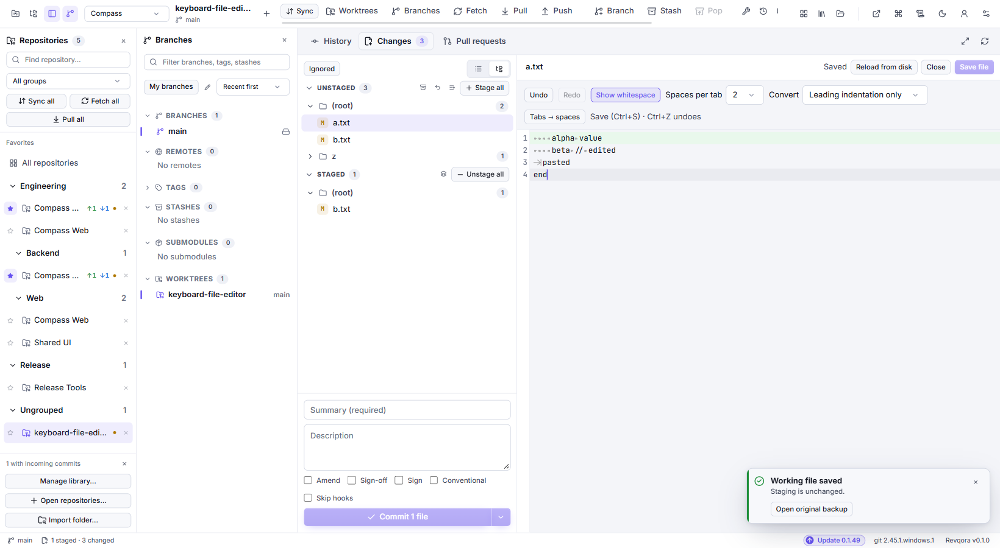

# Changes, staging and commits

**Where:** open a repository, then **Changes** or **Ctrl+2**.

## Understand the file lists

| State | Meaning |
| --- | --- |
| Unstaged | A tracked file differs from the staged version. |
| Staged | Content selected for the next commit. |
| Untracked | A new file that Git does not track yet. Stage it to include it. |
| Ignored | A file excluded by Git ignore rules. Inspect it through **Repository tools → Ignored files**. |
| Conflicted | Git needs a resolved result before the operation can continue. |

Staging is a selection mechanism. It does not hide a file, save it as a commit or upload it.

Use **↑ / ↓** to move through changed files. Choose **Edit working file** above
the diff to open the full working copy in that pane. The editor highlights added
and replaced lines and scrolls to the first highlight. **Save file** or **Ctrl+S**
writes the working copy, and **Close** returns to the diff. Switching files keeps
the unsaved draft in memory for this session.

## Example: commit one task and leave another unfinished

You changed `login.ts` and `theme.css`. Only the login fix is ready:

1. Select `login.ts` and inspect the diff.
2. Stage it with **+** or a double-click.
3. Confirm it appears in Staged.
4. Leave `theme.css` unstaged.
5. Enter a message and Commit.

The commit contains the staged login change. The theme edit remains in your working folder for another commit.

## Stage or unstage only part of a file

Open a file's diff and select the desired hunk or lines. Use the offered stage/unstage action for that selection. This is useful when one file contains two unrelated fixes.

If you stage a file and edit it again, it can appear in both lists: the staged version is ready for commit, while newer edits remain unstaged. Inspect both before committing.

**Stage file** reads the current file when you stage it. Staging it again
replaces the previous staged version. **Stage hunk** uses the selected
diff snapshot, so a later write to the working file can appear as a separate
unstaged change.

If a diff exceeds the preview size limit, its visible portion is marked partial.
Whole-file actions remain available.

**Unstage** removes content from the proposed commit and keeps your working edits. **Discard** removes working changes; review the selected files/lines and available recovery information before confirming it.

## Make a commit

Enter a summary and, when useful, a multiline description. The form also exposes commit helpers such as templates, Conventional Commits formatting, sign-off and signing options.

A normal Commit needs staged content and a message. It is disabled when conflicts or a blocking operation need attention. **Commit & push** creates a local commit and then attempts publication. If publication fails, inspect the already-created local commit and retry Push as appropriate.

Your Git author name/email is configured separately from GitHub or another API account. Set it through **Settings → Edit name & email**.

## What does Amend mean?

**Amend** replaces the most recent commit. Use it to correct its message or include additional staged content.

1. Stage any content you want to add.
2. Enable **Amend** in the commit form.
3. Check the message and changes.
4. Choose **Amend commit**.

The replacement has a new SHA. If the original was already pushed, ordinary Push may reject the changed history. Review the shared branch and coordinate before considering **force-with-lease**.

## Sign-off and signing

- **Sign-off** adds a `Signed-off-by` trailer to the message.
- **Signing** creates a cryptographic commit signature using your configured Git signing tools and key.

They serve different purposes. Revqora uses your installed Git configuration and signing tools; an API login does not create a signing key.

## Changes made outside Revqora

IDE, terminal and agent edits are detected by repository watchers. If an operation reports that its prepared state is stale, refresh, inspect the new content and prepare it again. The action was bound to an older view of the repository.

**Next:** [Publish with Push or Sync](https://github.com/bitcodepro/Revqora/wiki/Fetch-Pull-Push-and-Sync) · [Stage layers](https://github.com/bitcodepro/Revqora/wiki/Stash-stage-layers-and-patches) · [Resolve conflicts](https://github.com/bitcodepro/Revqora/wiki/Merge-rebase-and-conflicts)
