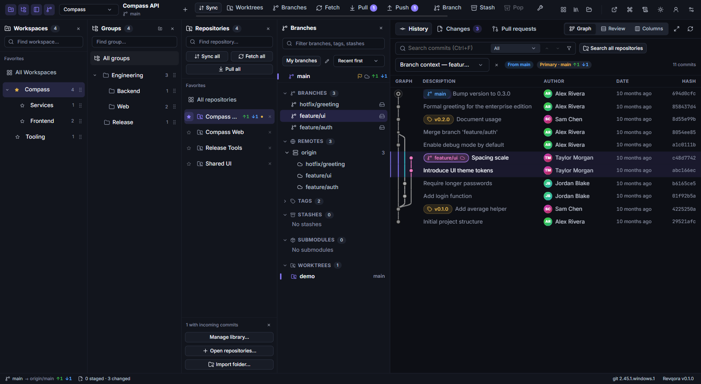

# Revqora user guide

Revqora is a desktop Git client for working with repositories, reviewing changes, managing pull requests and running reviewed agent workflows.

**New to the app? Start with [Quick start](https://github.com/bitcodepro/Revqora/wiki/Quick-start).** You do not need agents, workflows or advanced history tools to use Revqora for everyday Git work.

## The everyday workflow

1. Open a repository.
2. Get upstream changes with **Pull**, or inspect them first with **Fetch**.
3. Create or select your working branch.
4. Edit files in your editor.
5. Inspect **Changes**, stage the intended changes and **Commit**.
6. **Push** the commits.
7. Open **Pull Requests** to create or review a PR.

[Walk through your first change →](https://github.com/bitcodepro/Revqora/wiki/Quick-start)

## Find the right guide

| I want to… | Guide |
| --- | --- |
| Understand the screen, panels and review layouts | [Interface and navigation](https://github.com/bitcodepro/Revqora/wiki/Interface-and-navigation) |
| Add another repository without closing the app | [Explorer and repository library](https://github.com/bitcodepro/Revqora/wiki/Repositories-and-workspaces) |
| Understand staging, commit, amend and signing | [Changes and commits](https://github.com/bitcodepro/Revqora/wiki/Changes-and-commits) |
| Choose between Fetch, Pull, Push and Sync | [Remote operations](https://github.com/bitcodepro/Revqora/wiki/Fetch-Pull-Push-and-Sync) |
| Create, switch, rename or safely delete branches | [Branches and cleanup](https://github.com/bitcodepro/Revqora/wiki/Branches-and-cleanup) |
| Inspect a commit, compare branches or find changed code | [History, diff and search](https://github.com/bitcodepro/Revqora/wiki/History-diff-and-search) |
| Merge branches, resolve conflicts or edit commit history | [Merge, rebase and conflicts](https://github.com/bitcodepro/Revqora/wiki/Merge-rebase-and-conflicts) |
| Set work aside, prepare several commits or exchange patches | [Stash, stage layers and patches](https://github.com/bitcodepro/Revqora/wiki/Stash-stage-layers-and-patches) |
| Work on two branches in separate folders | [Worktree Manager](https://github.com/bitcodepro/Revqora/wiki/Worktree-Manager) |
| Connect GitHub, GitLab, Bitbucket or Azure DevOps | [Accounts and providers](https://github.com/bitcodepro/Revqora/wiki/Accounts-and-providers) |
| Create PRs, read discussions, review code or merge | [Pull Request Center](https://github.com/bitcodepro/Revqora/wiki/Pull-Request-Center) |
| Run Codex, Claude Code or another installed CLI | [Agent Workspace](https://github.com/bitcodepro/Revqora/wiki/Agent-Workspace) |
| Connect an external AI client to Revqora | [MCP](https://github.com/bitcodepro/Revqora/wiki/MCP) |
| Save a sequence of checks and reviewed actions | [Workflow Builder](https://github.com/bitcodepro/Revqora/wiki/Workflow-Builder) |
| Address PR feedback with an agent and check the result | [PR agent workflows](https://github.com/bitcodepro/Revqora/wiki/PR-agent-workflows) |
| Maintain dependent branches and their PRs | [Branch Stacks](https://github.com/bitcodepro/Revqora/wiki/Branch-Stacks) |
| Recover a branch or investigate an operation | [Recovery and repository tools](https://github.com/bitcodepro/Revqora/wiki/Recovery-and-repository-tools) |
| Configure the app or troubleshoot an error | [Settings, shortcuts and troubleshooting](https://github.com/bitcodepro/Revqora/wiki/Settings-and-troubleshooting) |

## Five terms that make the interface easier

| Term | Meaning |
| --- | --- |
| **Working tree** | Files in your repository folder, including your current edits. |
| **Staging / index** | The exact content selected for the next commit. Staging does not hide files. |
| **Commit** | A saved snapshot in local Git history. It is not uploaded until you push it. |
| **Upstream** | The branch your local branch tracks, such as `origin/main`. Pull and Sync use this relationship. |
| **Worktree** | Another working folder attached to the same Git repository, usually checked out on another branch. |

## Using this documentation

Button names are written as they appear in the English interface. **Ctrl+N** opens the command palette: search there if a toolbar action is hidden or you cannot find an icon.

This guide follows the current source. Check **Settings → About Revqora** and the [release notes](https://github.com/bitcodepro/Revqora/releases) for the features in your installed build.

*The screenshot uses a demo repository. Your repository names and history will differ.*

**Author:** [bitcodepro](https://github.com/bitcodepro). [Source code](https://github.com/bitcodepro/Revqora) · [Report a problem](https://github.com/bitcodepro/Revqora/issues)
