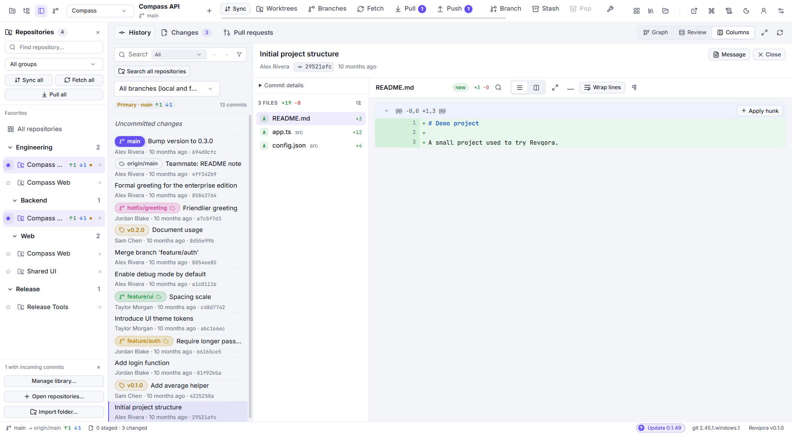

# Interface and navigation

## The main areas

| Area | What to look for |
| --- | --- |
| Top bar | Explorer, Repositories and Branches toggles, then the active repository and Git actions. The library and repository overview are on the right. |
| **Explorer** | Expand a tree of groups and repositories. Select a group to filter the flat repository list. |
| **Repositories** panel | Optional flat list of open and saved repositories, with search, favorites and bulk remote actions. |
| **Branches** panel | Local branches, remotes, tags, stashes, submodules and worktrees. |
| **History** | Commit list/graph, selected commit, changed files and diff. |
| **Changes** | Your uncommitted working and staged changes, stage layers and commit form. |
| **Pull Requests** | Hosting-service PRs/MRs, files, discussions, reviews and checks. |
| Bottom status bar | Current Git state, version information and available application updates. |

Most top-bar Git actions apply to the current repository's checked-out branch. The History, Changes or Pull Requests tab follows you when you switch repositories.
Explorer's filled repository row marks the active repository. The keyboard focus outline shows where arrow-key navigation is positioned.

## Three history layouts

Open **History** with **Ctrl+1**, then choose a layout:

- **Graph** emphasizes branch topology and merge relationships.
- **Review** gives commit rows and the selected commit's changes more space.
- **Columns** arranges **commits → changed files → diff** from left to right.

Cycle layouts with **Ctrl+Shift+R**. Each layout remembers its Repositories and Branches visibility and panel widths. The Explorer toggle is shared across layouts.

## Give the diff more space

Toggle **Explorer**, **Repositories** or **Branches** with **Ctrl+Alt+W**, **Ctrl+Alt+R** or **Ctrl+Alt+B**. Explorer opens by default, and the optional Repositories panel starts hidden. Drag pane dividers to resize and use **Ctrl+Shift+Enter** for focus mode. Resize dialogs from the bottom-right corner. Revqora remembers panel and dialog sizes.

Right-click a supported panel heading and choose **Detach**, or open it from **Panels in separate windows**. Drag the window to another monitor. Right-click its heading and choose **Attach**, or select **Return to main window** to restore the panel.

## Read a selected commit

Click a commit to open its preview. The changed-file list chooses which diff to display. **Message** opens the full message in a separate reader, including a long description or trailers such as `Co-authored-by`. **Close** dismisses the commit preview.

Use the diff controls to choose unified or side-by-side display. Enable **Wrap lines** to fit long lines inside the pane; leave it off to use horizontal scrolling. **F7** and **Shift+F7** move between changes.

Reading a commit does not check it out. Checking out a commit is a separate action and can put the working copy into detached HEAD state.

## Find commands without remembering icons

Press **Ctrl+N** and type part of an action, repository, branch, or folder name. Use the arrow keys to choose a result and **Enter** to open it. Repository and folder results reveal their location in Explorer. A branch result opens the Branches panel and shows its history without checking it out. Include the repository name to distinguish branches with the same name.

Shortcuts use physical key positions across keyboard layouts. To update a legacy shortcut saved as a layout-specific character, record it again under **Settings → Shortcuts**.

Examples:

- `Open repository`
- `Branch manager`
- `Worktree manager`
- `Accounts and API connections`
- `Undo Center`
- `Agent Workspace`
- `Workflow Builder`
- `History Explorer`

Some commands appear only after opening a repository. Context menus on branches, commits and files provide actions for that specific item.

Right-click empty space in the top bar for named toolbar actions such as **Settings**, **Pull**, **Push** and **Check Updates**.

## Three kinds of refresh

- **F5** refreshes the current local repository view.
- **Fetch** contacts Git remotes to update available remote history.
- **Refresh pull requests** / **Reload request** contacts the hosting API for PR information.

Use the refresh control for the data you want to update. Fetching commits does not load new PR discussion comments.

**Related:** [Explorer and repository library](https://github.com/bitcodepro/Revqora/wiki/Repositories-and-workspaces) · [History and search](https://github.com/bitcodepro/Revqora/wiki/History-diff-and-search) · [Keyboard shortcuts](https://github.com/bitcodepro/Revqora/wiki/Settings-and-troubleshooting)
