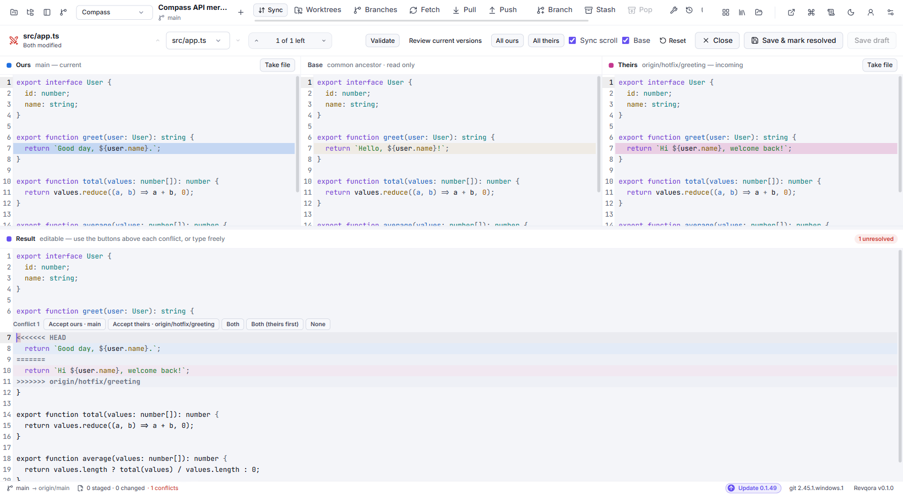

# Merge, rebase and conflict resolution

## Choose an operation

| Operation | Use it for | Effect |
| --- | --- | --- |
| Merge | Integrate another branch into the current branch. | Keeps both histories; may create a merge commit after confirmation. |
| Rebase | Replay your commits on a new base. | Creates replacement commits with new SHAs. |
| Cherry-pick | Copy selected commits onto the current branch. | Applies those changes as new commits. |
| Revert | Undo a recorded commit through another commit. | Preserves existing history. |
| Reset | Move the current branch to another commit. | Also affects staging/working files according to the selected mode. |

Check the current branch before opening an operation. The branch receiving a merge or cherry-pick is the checked-out branch.

## Cherry-pick or revert a commit

For cherry-pick, check out the receiving branch, find the source commit in History, right-click it and choose **Cherry-pick**. For several selected commits, review the **Cherry-pick N commits** action and their application order. Inspect the new commits or resolve the reported conflicts before continuing.

For revert, right-click the commit to undo and choose **Revert commit**. Review the resulting change/operation and complete it through the offered controls. The existing commit remains in history; the inverse change is recorded separately. Publish it afterward when needed.

## Merge another branch

Example: integrate `feature/login` into `main` locally.

1. Check out `main`.
2. Choose the feature branch's **Merge … into current…** action, including through **Ctrl+N**.
3. Review the target and merge strategy.
4. Resolve any conflicts.
5. Inspect the staged result and choose **Confirm merge** when a merge commit is needed.

A fast-forward can advance the pointer without creating a new merge commit. A non-fast-forward merge is prepared for explicit confirmation. Creating a local merge does not automatically push it or merge its hosting-service PR.

## Use Rebase Studio

In History, right-click the oldest commit you want to edit and choose **Edit history → Interactive rebase from here…**. Inspect the selected range and affected/published history before starting.

| Action | Meaning |
| --- | --- |
| Pick | Keep the commit. |
| Reword | Keep its changes and edit its message. |
| Squash | Combine it with the preceding commit and review the combined message. |
| Fixup | Combine its changes with the preceding commit, normally keeping the earlier message. |
| Drop | Remove it from the rewritten history. |
| Reorder | Change the sequence in which commits are replayed. |

Check the preview and recovery point. Rewriting published commits may require a separately reviewed force-with-lease push. Use **Repository tools → Rebase Studio result** to inspect the recorded outcome.

## Resolve a conflict

Open a conflicted file from **Changes** or choose **Resolve conflicts** in the operation banner.

1. Read **Base**, **Ours** and **Theirs**.
2. Accept the appropriate blocks or edit **Result** manually.
3. Inspect the entire resulting file, including code around each block.
4. Choose **Save & mark resolved** to stage the result.
5. Repeat for the remaining files.
6. Continue the merge/rebase/cherry-pick using its operation banner.

During rebase, Ours/Theirs follow Git's current operation: the target and replayed commit can be the opposite of what you intuitively call “my side.” Read the displayed revisions before choosing a whole side.

**Save draft** writes the current result without marking it resolved. An unsaved editor buffer can survive navigation during the current app session, but is not guaranteed after quitting. Save before exit.

**Abort** returns through the operation's abort path. Check recovery information for manual edits made since the operation began.

## Validate the result

Choose **Validate**, enter a command such as `npm test`, `dotnet test` or `cargo test`, review its working directory and run it explicitly. Output and the exit code appear in the check result. **Cancel check** stops the managed process tree.

A successful check becomes stale if Git-visible content changes. A command that changes source files can invalidate its own result. Validation remains optional; a failed/stale result requires the displayed acknowledgment before continuing.

If a file was resolved outside the editor, retained drafts are available through **Validate → Retained drafts for resolved files** or **Repository tools → Validate / conflict drafts**. Inspect/copy/discard the retained text as needed.

## Reset modes

In History, right-click the destination commit and choose **Reset <current branch> to here…**. Check the destination and choose the intended mode:

- **Soft:** moves the branch pointer and keeps the index/working content.
- **Mixed:** also resets staging; working-file edits remain.
- **Hard:** also resets tracked working content to the target commit.

Reset is not a way to undo a remote operation automatically. For shared history, inspect whether Revert better matches your intent. See [Recovery](https://github.com/bitcodepro/Revqora/wiki/Recovery-and-repository-tools) before relying on restoration of uncommitted content.
