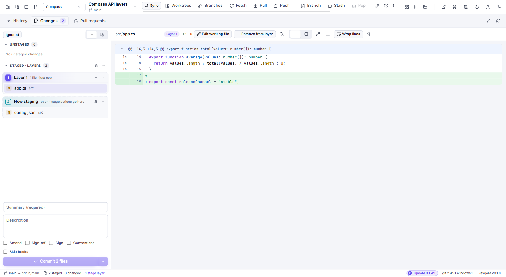

# Stash, stage layers and patches

These tools organize work at different levels: Stash sets edits aside, stage layers prepare separate commits, and patch files transfer changes outside the normal Push/PR path.

## Stash: temporarily set work aside

Use **Ctrl+Shift+S** or **Ctrl+N → Stash changes…** when you need a cleaner working copy before switching context.

1. Inspect your changed files.
2. Open Stash and enter a recognizable message.
3. Review whether the offered options include untracked files and other intended content.
4. Save the stash and check the working state.

Existing stashes appear in **Branches → Stashes**. Inspect the selected stash before restoring it.

| Action | Result |
| --- | --- |
| Apply | Restores changes while retaining the stash entry. |
| Pop | Applies the stash and removes it after successful application. If conflicts occur, inspect the retained entry/result. |
| Drop | Removes the saved entry; it does not apply the changes first. |

Stash is local Git data. It is not uploaded by an ordinary Push. After applying a stash on another branch, inspect and commit the restored changes there.

Apply and Pop try to restore the saved index along with the working changes. If Git can restore only the working changes, Revqora shows a staging comparison and keeps the stash. **Restore file** writes the chosen version to the working tree and leaves the index in place.

## Partial stash

For supported tracked changes, select the intended lines/hunks in the working diff and use the partial-stash action. Inspect the resulting working files afterward: unrelated edits should remain.

Partial stash is useful when only one part of a mixed file needs to be set aside. If the file or repository changed since the diff loaded, reload and choose the selection again.

## Stage layers: prepare several logical commits

**Where:** the staging area in **Changes**.

Example: one working copy contains a refactor and a small bug fix, and you want two commits.

1. Stage the refactor's intended files/lines.
2. Use the layer control to seal that staged group.
3. Stage the bug fix on top.
4. Select each layer to inspect its files and diff.
5. Commit the appropriate layer after reviewing its contents and message.

Layer actions allow you to inspect, rename, unstage, reorder or combine prepared groups. When groups depend on the same lines, resolve the dependency using the displayed conflict controls.

Use a layer's context menu or **More** action for its available operations. **Layer options → Merge all layers into one** combines prepared groups; **Unstage everything** returns their changes to the working preparation state. Inspect the result before your next commit, especially when the same lines appear in several layers.

Stage layers belong to one working copy's preparation process. **Branch Stacks** manage actual dependent branches and PRs; see [that guide](https://github.com/bitcodepro/Revqora/wiki/Branch-Stacks) when each piece needs its own branch.

## Export and apply patches

Use the selected commit(s)' patch-export action to save a `.patch` file. To import, use **Ctrl+N → Apply patch file…** or **Repository tools → Apply patch file…**.

1. Select the patch file.
2. Read the result and any conflict report.
3. Inspect Changes/history to see how that patch format was applied.
4. Resolve or continue an interrupted application with the offered operation controls.

Patch files can contain source code and commit metadata. Share only the content you intend to share. Applying a patch does not itself create a remote PR or publish a branch.

**Related:** [Staging and commit](https://github.com/bitcodepro/Revqora/wiki/Changes-and-commits) · [Conflicts](https://github.com/bitcodepro/Revqora/wiki/Merge-rebase-and-conflicts) · [Recovery](https://github.com/bitcodepro/Revqora/wiki/Recovery-and-repository-tools)
